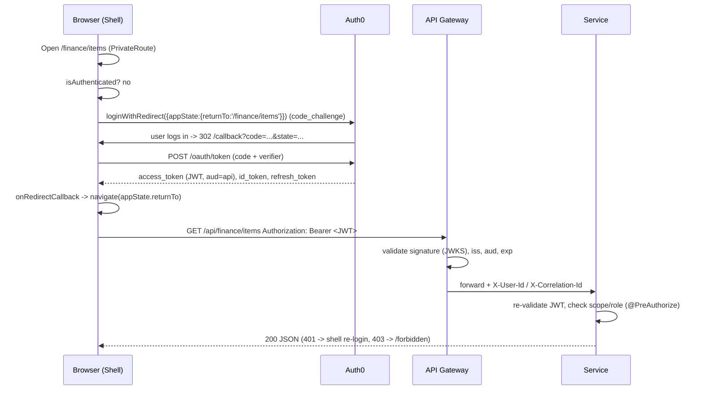

# Platform Architecture: Microservices + Micro-Frontends

Modelled on the existing Norstella stack: `fusprtl-webui` (shell), `*-webui` (remotes), `*-service` (Spring Boot), Auth0 (identity).

## 1. High-level view

```mermaid
flowchart LR
  U[Browser] -->|HTTPS| CDN[CDN / Static hosting]
  CDN --> SHELL[Shell / Container<br/>React + Module Federation host]
  SHELL -. runtime load remoteEntry.js .-> R1[Remote: Finance UI]
  SHELL -. runtime load .-> R2[Remote: Drug Master UI]
  SHELL -. runtime load .-> R3[Remote: Org/Reg UI]

  U -->|Login redirect| IDP[(Auth0 / OIDC IdP)]
  IDP -->|code + PKCE -> /callback| SHELL

  SHELL -->|Bearer JWT| GW[API Gateway<br/>Spring Cloud Gateway]
  R1 -->|Bearer JWT| GW
  R2 --> GW
  R3 --> GW

  GW --> S1[finance-service]
  GW --> S2[drug-service]
  GW --> S3[org-service]
  GW --> S4[user-profile-service]

  S1 --> DB1[(Postgres / Graph DB)]
  S2 --> DB2[(Postgres)]
  S3 --> DB3[(Postgres)]
  S4 --> DB4[(Postgres)]

  S1 <-->|events| MQ[[Kafka / RabbitMQ / Service Bus]]
  S2 <--> MQ
  S3 <--> MQ

  GW -. validates JWT via JWKS .-> IDP
  S1 -. validates JWT (resource server) .-> IDP
```

## 2. Micro-frontend architecture

| Concern | Decision |
|---|---|
| Composition | Webpack 5 **Module Federation**. Shell = host, each domain UI = remote exposing `./Module`. |
| Shell owns | Auth0 provider, routing, layout/menu, user profile, shared stores, design-system, env config. |
| Remote owns | Domain screens, domain state, domain API client. Must run standalone (own dev server) and inside shell. |
| Shared singletons | `react`, `react-dom`, `react-router-dom`, `@auth0/auth0-react`, UI lib (MUI). `singleton: true`, `requiredVersion` from package.json. |
| Remote discovery | Runtime manifest (`remotes.json` served by shell or config service) -> `external-remotes-plugin` so URLs change per environment without rebuilding the shell. |
| Shell -> remote contract | Remote exposes `./Routes` (array of `{path, element, permission}`) and optional `./Menu`. Shell registers them dynamically. |
| Remote -> shell contract | Shell exposes `./useUserProfile`, `./useContainerStore`, `./EnvironmentProperties`, `./components`, `./apiClient` (token-aware axios). Remotes never create their own Auth0 provider. |
| Types | `@module-federation/typescript` / `@mf-types` for typed remote imports. |
| Failure isolation | Each remote mounted inside `ErrorBoundary` + `Suspense`; retry via `webpack-retry-chunk-load-plugin`. |
| Styling | Scoped (CSS modules / MUI theme from shell) to avoid leakage. |
| Deployment | Each remote has its own repo/pipeline/bucket. Shell is only redeployed if the contract changes. |

### Repo layout (target)

```
platform/
├─ shell-webui/                # host (like fusprtl-webui)
│  └─ app/{webpack.config.js, src/{modules/{auth0,Routes,App}, store, utils}}
├─ finance-webui/              # remote (like finmstr-webui)
├─ drug-webui/                 # remote (like drugmstr-webui)
├─ org-webui/                  # remote
├─ api-gateway/                # Spring Cloud Gateway
├─ finance-service/            # Spring Boot (like finmstr-service)
├─ drug-service/
├─ org-service/
├─ user-profile-service/
├─ infra/                      # terraform, docker-compose, k8s
└─ docs/
```

## 3. Authentication & authorization

**Flow: OIDC Authorization Code + PKCE (SPA), Auth0 as IdP.**



### Rules
- Token lives **in memory** (Auth0 SPA SDK, refresh-token rotation, `cacheLocation: memory`). No tokens in localStorage.
- Shell is the **only** place that talks to Auth0. Remotes get tokens via the shell's shared `apiClient` / `useAuth0` (singleton).
- Gateway = coarse check (valid JWT, aud, iss). Services = fine-grained (roles/permissions claim e.g. `permissions: ["finance:read"]`) via Spring Security `oauth2ResourceServer().jwt()`.
- Service-to-service: OAuth2 **client credentials** (M2M) or propagate the user JWT; never trust unauthenticated internal calls.
- CORS only on gateway, allowed origins from env.

## 4. Redirection design

| Scenario | Behaviour |
|---|---|
| Unauthenticated deep link `/finance/items?id=5` | `PrivateRoute` stores `returnTo = pathname+search`, calls `loginWithRedirect`. After `/callback`, `onRedirectCallback` navigates to `returnTo`. |
| Login success, no returnTo | Redirect to role-based landing page (`/home`). |
| `/login` | Public page with Login button (already in `App.tsx`). Authenticated visitors are redirected to `/home`. |
| `/callback` | Handles code exchange, shows spinner, then navigates. Error -> `/auth-error`. |
| Token expired / 401 from gateway | Interceptor tries `getAccessTokenSilently()`; if it fails -> `loginWithRedirect` with current URL as `returnTo`. |
| 403 | Navigate to `/forbidden` (remote menu entry hidden by permission). |
| Logout | `logout({ logoutParams: { returnTo: origin + '/login' } })`. Allowed Logout URLs configured in Auth0. |
| Unknown route | `*` -> `/not-found` (or `/home`). |
| Remote path ownership | Shell mounts remote routes under a prefix: `/finance/*`, `/drug/*`. Remote uses relative routes only, so it works standalone and hosted. |
| Open-redirect protection | `returnTo` must start with `/` and not `//`; validate before navigating. |

Auth0 tenant settings per environment: Allowed Callback URLs (`https://<host>/callback`), Allowed Logout URLs, Allowed Web Origins; API audience `https://api.<org>/platform`.

## 5. Microservices architecture

| Component | Tech | Responsibility |
|---|---|---|
| API Gateway | Spring Cloud Gateway | Routing (`/api/finance/**` -> finance-service), JWT validation, rate limiting, CORS, correlation ID, request logging. |
| Domain services | Java 17, Spring Boot 3, Gradle | One bounded context each, own DB (database-per-service), REST + OpenAPI, Flyway migrations. |
| Config | Env vars + `application-config.yml` per env (Key Vault / Secrets Manager for secrets). |
| Messaging | Kafka / Service Bus for async domain events (`ItemUpdated`, `ProductCreated`); outbox pattern for reliability. |
| Real-time | STOMP/WebSocket from the service that owns the feature (as `useStompjs` in shell). |
| Observability | Micrometer + OpenTelemetry -> New Relic/Grafana; structured JSON logs with `traceId`; `/actuator/health`. |
| Resilience | Resilience4j (timeout, retry, circuit breaker) on inter-service calls. |
| API contract | OpenAPI spec per service; generated TS client consumed by remotes. |

Service package layout:
```
com.<org>.<domain>
├─ api/          controllers, DTOs, exception handlers
├─ domain/       entities, domain services
├─ repository/
├─ config/       SecurityConfig, OpenApiConfig
└─ integration/  clients, event publishers/listeners
```

## 6. Environments & delivery

- Environments: local -> dev -> qa -> uat -> prd (matches existing `start:qa`, `build:uat` scripts).
- CI/CD: Azure Pipelines per repo (`azure-pipeline.yml`) -> build, test, scan, containerize/static publish -> Terraform-managed infra.
- Frontends: static assets to blob/S3 + CDN; `remoteEntry.js` served with `Cache-Control: no-cache`, hashed chunks cached long-term.
- Backends: Docker image -> AKS/ECS/App Service; blue/green or rolling.
- Versioning: remotes backwards compatible with the shell's exposed contract; semantic version in `version.info`; contract tests (Pact) between UI and services.

## 7. Cross-cutting decisions (ADR summary)

1. Module Federation over iframes/single-spa: shared React runtime, simple dev experience, already used.
2. Auth in the shell only: one login, one token, SSO across remotes.
3. Gateway + resource-server defence in depth.
4. Database per service; no cross-service joins; use events/APIs.
5. Runtime remote manifest so environment changes need no rebuild.
